# CareFlow AI

**A human-in-the-loop triage assistant for Indian clinics.** CareFlow reads what patients send (typed messages, voice notes, report photos and PDFs, in English, Hindi, Hinglish and other Indian languages), turns it into a structured, source-linked summary, and suggests who should be seen first and why. It flags what is missing, unclear, conflicting or suspicious, asks the right follow-up questions in the patient's language, and drafts a triage note.

**It never diagnoses and never decides.** Every case is approved, edited or overridden by a doctor or nurse, and every decision is recorded.

Built solo in three days for the Confluentia 2026 hackathon (Tredence, problem statement 4).

---

## What it does, mapped to the brief

| The brief asks for | CareFlow | Where |
|---|---|---|
| Text and voice input, OCR of reports, symptom timeline, missing information | Typed or recorded input; PDF text layer → local Tesseract → Gemini escalation; faster-whisper on the GPU; timeline extraction; 15 complaint checklists | Intake page; `services/ingestion`, `services/validation/missing.py` |
| English, Hindi, regional, Hinglish; show uncertainty | Multilingual negation-aware symptom lexicon; translation with confidence; low-confidence transcription and translation flags | `services/triage/text_match.py`, `services/ingestion/translation.py` |
| Warning signs, prioritisation, follow-up questions, urgent alerts | 45 red-flag rules (MTS, ESI, WHO ETAT/IMCI, Indian guidelines, critical labs) + NEWS2; P1–P4 with review-time targets; questions in Hindi, Hinglish or English | `rules/red_flags.yaml`, `services/triage/engine.py` |
| Conflicts, illegible reports, low confidence, suspicious instructions: flag, don't guess | Discrepancies kept, never resolved silently; another patient's report; denied vs measured; prompt-injection detection with masking; confidence capped by OCR/ASR confidence | `services/validation/` |
| Prioritised list, provenance, approve/edit/override | Review queue with time-to-target bars; click any fact to see the report line boxed or the voice note cued to the second; versioned note; override needs a reason | Review queue and case page |
| Consent, withdrawal, deletion, roles, audit | Consent slip with a self-service withdrawal code; erasure of files and records; four least-privilege roles; identifiers redacted before any cloud call; hash-chained audit log | `services/privacy/`, Audit log and Data requests pages |
| Bonus: small language model | Extraction, translation and follow-up questions run on a local model under 20B parameters (Ollama); Gemini only as fallback or for hard scans | `services/llm/ollama_slm.py` |
| Bonus: innovation | Shadow-trained agent that learns local clinical judgement from clinicians' decisions without influencing them until it graduates; similar-case memory; evaluation with a held-out set | Learning and Evaluation pages |

Full requirement-by-requirement traceability: [docs/requirements-traceability.md](docs/requirements-traceability.md).

---

## How a case flows

```mermaid
flowchart LR
  A[Message / voice note / report<br/>+ consent] --> B[Ingestion<br/>OCR, speech, translation<br/>with confidence]
  B --> C[Injection scan<br/>mask before any model]
  C --> D[Extraction<br/>local small model → Gemini → rules]
  D --> E[Deterministic checks<br/>vitals, labs, symptom scan,<br/>grounding to source spans]
  E --> F[Triage engine<br/>red flags + NEWS2<br/>most urgent wins]
  F --> G[Validation<br/>missing · unclear ·<br/>conflicting · suspicious<br/>+ follow-up questions]
  G --> H[Shadow agent<br/>records its guess, blind]
  H --> I[Draft note]
  I --> J{Clinician}
  J -->|approve / edit / override| K[Final priority]
  K -->|training signal| H
```



**Safety rules the code enforces (and the tests check):**
- The most urgent signal wins. Nothing (model, learned agent, or text in an input) can lower a rule-based priority.
- Uncertain, empty, unreadable or tampered inputs are never left at routine.
- Every warning sign links to the exact text, report line or audio moment it came from.
- The learned agent has no effect in shadow mode and can only raise a priority in recommendation mode.

Architecture in detail: [docs/architecture.md](docs/architecture.md). Assumptions: [ASSUMPTIONS.md](ASSUMPTIONS.md).

---

## Results

### Evaluation set

112 gold-labelled cases ([`backend/data/eval/eval_cases.json`](backend/data/eval/eval_cases.json)): urgent and routine presentations, denied symptoms, Hinglish and Devanagari Hindi, Bengali, Tamil, Telugu and Marathi, report images and PDFs, conflicting and tampered inputs. Expected priorities come from case content, not from system output. These cases are **synthetic** (written by us, not real patients). The real-data check is the KTAS emergency-department dataset (see below).

**How the held-out set is kept honest.** Held-out set 1 (20 cases) exposed real gaps in the first small-model run. We used its misses to fix the pipeline, so it is now part of the **development** set (92 cases) and no longer counts as unseen. Held-out set 2 (20 cases, `hx01`–`hx20`) was written *before* those fixes. Its labels are locked by a SHA-256 hash stored in the file. No synonym or rule was added from its wording.

Offline baseline, **rules only, no language model** (`python -m scripts.run_eval`):

| | Development (92) | Held-out set 2 (20) |
|---|---|---|
| Exact priority | 91% | 55% |
| Urgent (P1/P2) suggested as less urgent | **9%** (5 of 56) | **70%** (7 of 10) |
| Weighted kappa | 0.87 | 0.38 |

**Local small model (Qwen2.5 3B via Ollama, Apple Silicon Mac, 8 GB) on held-out set 2**, the run made before any further change:

| Held-out set 2 (20) | Rules only | Qwen2.5 3B + rules |
|---|---|---|
| Exact priority | 55% | **70%** |
| Urgent (P1/P2) suggested as less urgent | 7 of 10 | **4 of 10** |
| Two or more levels too low | 6 | **2** |
| Weighted kappa | 0.38 | **0.66** |
| Time per case | 0.2 s | 19 s |

Changes made after looking at this run (signal checking, symptom-id reconciliation) are measured on the development set and on real KTAS data, not on held-out set 2 again.

Across all 112: expected warning signs detected 100%; no routine case raised to P1/P2; suspicious-input flag 100% recall and precision; conflicting 100% recall, 88% precision; about 155 ms per case on a CPU.

**What this shows, honestly.** The keyword safety net is reliable on phrasings it knows and poor on new ones ("tight pressure in the chest, clammy", "lips look blue"). That is exactly why it is the *backstop*, not the extractor: the local small model reads paraphrases and other languages, and the lexicon catches what a model might drop. Without a translation model, Bengali, Tamil and Marathi messages are flagged for a human but not understood. The first evaluation run also found three real bugs that were fixed before the held-out set was written: Bengali text detected as Hindi (shared danda character), and missing phrasings for overdose and suicidal intent.

Run the same set with the small model and with Gemini to fill in the comparison (rows appear on the Evaluation page automatically):

```bash
python -m scripts.run_eval --provider ollama
python -m scripts.run_eval --provider gemini
```

### Real data: KTAS emergency-department triage

The synthetic set tests the brief's features (languages, reports, conflicts, tampering). For an independent check on **real patients**, we use the public KTAS dataset: 1,267 adult emergency-department visits from two hospitals in Korea (Moon et al., 2019; Kaggle "Emergency Service – Triage Application"). Each visit has the chief complaint, vital signs, the triage nurse's level and an expert panel's level.

- **Input:** sex, age, chief complaint, injury, pain score, mental state, BP, pulse, respiratory rate, temperature and SpO2.
- **Ground truth:** the expert KTAS level (1→P1, 2→P2, 3→P3, 4–5→P4).
- **Human baseline:** the nurse's KTAS level on the same patients, scored the same way.
- **Never used as input:** diagnosis, disposition, length of stay and the mistriage columns.

```bash
python -m scripts.import_ktas ~/Downloads/data.csv                 # all rows
python -m scripts.import_ktas ~/Downloads/data.csv --sample 150    # stratified sample (keeps every P1) for the slow model
python -m scripts.run_eval --cases data/eval/ktas_cases.json --name ktas-rules
python -m scripts.run_eval --cases data/eval/ktas_cases.json --provider ollama --name ktas-ollama
# the reported test: a second sample that shares no patient with the first
python -m scripts.import_ktas ~/Downloads/data.csv --sample 150 --seed 7 --split ktas-test --exclude data/eval/ktas_cases.json --out data/eval/ktas_test.json
python -m scripts.run_eval --cases data/eval/ktas_test.json --name ktas-test-rules
python -m scripts.run_eval --cases data/eval/ktas_test.json --provider ollama --name ktas-test-ollama
```

**Keeping it honest.** The first sample of 150 (`ktas_cases.json`, seed 24) became **KTAS-dev**: its misses exposed real bugs, and we fixed them. The bugs were: unresponsive or pain-only patients from the ACVPU field were not raised to P1, there was no cardiac-arrest rule, and ED shorthand such as "Abd pain", "Pain, chest", "mental change" and "hemiparesis" was not recognised. The reported real-data result is a second, **disjoint** sample of 150 (**KTAS-test**, `--exclude` makes sure no visit is reused). It is run once, after the fixes.

Rules only on KTAS-dev, before → after the fixes (nurse on the same 150 patients for reference):

| KTAS-dev (150) | Rules before | Rules after | Triage nurse |
|---|---|---|---|
| Urgent (P1/P2) rated less urgent | 46% (22 of 48) | **12%** (6 of 48) | 27% (13 of 48) |
| Two or more levels too low | 5 | 3 | 0 |
| Over-triage | 41% | 38% | 1% |
| Exact priority | 41% | 51% | 85% |

CareFlow misses fewer urgent patients than the nurse, but sends many more routine patients up a level. Most of that comes from a deliberate choice: any NEWS2 score of 1 or more (for example, a pulse of 100) lifts a routine case to same-day review (P3). The nurse sees the patient and the system does not, so the nurse is better at saying "this one can wait".

**Result on KTAS-test** (150 visits never looked at; Qwen2.5 3B + rules; run once):

| KTAS-test (150) | CareFlow (3B + rules) | Triage nurse |
|---|---|---|
| Urgent (P2) rated less urgent | **26%** (7 of 27) | 37% (10 of 27) |
| Two or more levels too low | 1 | 1 |
| Over-triage | 44% | 2% |
| Exact priority | 41% | 84% |
| Weighted kappa | 0.25 | 0.77 |

Read it honestly. CareFlow misses fewer urgent patients than the nurse did, but it sends far more routine patients up a level. Its exact agreement with the expert panel is much lower than the nurse's. That is acceptable only because CareFlow suggests and a clinician decides. Over-triage costs clinician time; under-triage costs patients. Limitation: KTAS-test contains no level-1 patients, because the dev sample kept every level-1 visit (the stratified sampler keeps all P1). The P1 behaviour on real data is therefore only shown on KTAS-dev (expert level 1: CareFlow with the small model gave 23 of 26 P1, 2 got P2 and 1 got P4).

The over-triage dial is `NEWS2_LOW_LIFT_MIN` (default 1: any abnormal vital lifts a routine case to P3). On KTAS-dev with rules only, raising it to 2 cuts over-triage from 38% to 30%. Urgent misses stay the same, but one more case lands two levels too low. So the default stays cautious, and a clinic can choose.

The Evaluation page then shows CareFlow next to the nurse on the same patients. Caveats: these are Korean adult emergency visits, complaints are short clinical English, and KTAS levels are not identical to our P1–P4 scale.

### Shadow learning (simulated 6 months, 20 reviewed cases a week)

| Last 100 cases | Learned agent | Rules alone |
|---|---|---|
| Agrees with the clinician | 86% | 66% |
| Urgent patients suggested as less urgent | 4% | 49% |

The agent learned local judgement the rules do not encode (fever over 65, diabetes with vomiting, headache in pregnancy → P2) and, because under-triage costs five times more than over-triage, did not learn to downgrade young adults with chest pain. Across three random seeds agreement stayed between 81% and 88% while under-triage ranged from 4% to 17%, driven by the simulated clinicians' own disagreement; the graduation checks block recommendation mode on the bad runs. `python -m scripts.simulate_shadow` or the Learning page.

---

## Run it

**Requirements:** Python 3.11+, Node 20+. Optional: [Ollama](https://ollama.com) (local small model), Tesseract with Hindi (local OCR), ffmpeg, a Gemini API key.

```bash
# backend
cd backend
python -m venv .venv && source .venv/bin/activate         # Windows: .venv\Scripts\activate
pip install -r requirements.txt                           # + requirements-gpu.txt for local speech-to-text
cp ../.env.example .env                                   # set JWT_SECRET; pick OLLAMA_MODEL; optional GEMINI_API_KEY
python -m scripts.make_samples                            # synthetic report images and PDF
python -m scripts.seed_db --reset --bootstrap 300         # 15 demo cases + warm up the shadow agent
uvicorn app.main:app --reload --port 8000                 # API docs at http://localhost:8000/docs

# frontend (new terminal)
cd frontend
npm install
npm run dev                                               # http://localhost:5173
```

Or start both with `./start-dev.sh` (macOS/Linux) or `.\start-dev.ps1` (Windows) after the installs.

**Local small model:** check GPU memory with `nvidia-smi`, then `ollama pull qwen2.5:3b-instruct` (4–6 GB) or `qwen2.5:7b-instruct` (8 GB+) and set `OLLAMA_MODEL`. With no model, `LLM_PROVIDER=rules` runs everything on the deterministic path.

**Optional engines:** Tesseract (`tesseract-ocr tesseract-ocr-hin`; on Windows the UB Mannheim installer with Hindi ticked), `pip install -r requirements-gpu.txt` for faster-whisper, ffmpeg for browser recordings. Whatever is missing is skipped; a document nothing can read is flagged unreadable and lifted to at least P3.

**Demo accounts** (password `careflow-demo`, set by `DEMO_PASSWORD`):

| Username | Role | Can |
|---|---|---|
| `dr.mehra` | Doctor (clinical lead) | Everything clinical; switch the learned agent's mode |
| `sr.thomas` | Nurse | Everything clinical |
| `desk.ravi` | Intake desk | Register, upload, answer questions, see contact details; no clinical note, no finalizing |
| `admin` | Data protection officer | Consent withdrawals, erasure, audit log, users; sees priority and status, not patient text |

**Tests:** `pytest -q` in `backend/` (about 150 tests, fully offline) and `npm test` in `frontend/` (19 page tests against real API responses).

---

## Pages

- **Review queue:** open cases by suggested priority with time-to-target bars; overdue patients climb within their band, never above a more urgent one; counts of what needs checking.
- **New case:** consent first (English and Hindi), message, voice recording, reports, vitals; prints a consent slip with a withdrawal code.
- **Case:** why this priority (with evidence), patient summary, flags, follow-up questions with inline answers, similar past decisions, triage note with approve / override, activity log; source viewer on the right.
- **Learning:** shadow-mode status, graduation checklist, live learning curve and confusion matrix, one-click simulation.
- **Evaluation:** safety-first metrics, development vs held-out, comparison across extraction setups, every miss listed.
- **Audit log:** every action by staff, AI and system; tamper check over the hash chain.
- **Data requests:** withdrawn patients and permanent erasure.
- **/withdraw:** public page where a patient withdraws consent with their slip code.

---

## Project structure

```
careflow-ai/
├── backend/
│   ├── app/
│   │   ├── api/            auth, cases, review, privacy, learning, evaluation, system
│   │   ├── models/         patient, case, source, triage result, note, review, audit, user, shadow prediction
│   │   ├── schemas/        evidence-linked extraction, triage output, validation report, API bodies
│   │   ├── services/
│   │   │   ├── llm/        provider interface, Ollama (small model), Gemini (redacted, logged)
│   │   │   ├── ingestion/  documents (OCR), audio (speech), translation, language, storage
│   │   │   ├── extraction/ prompts, extractor, vitals / labs / demographics parsers, grounding
│   │   │   ├── triage/     symptom scanner, red flags, NEWS2, engine, note
│   │   │   ├── validation/ checklists, conflicts, injection detection, follow-up questions
│   │   │   ├── learning/   features, bandit agent, shadow / recommend, similar cases, simulator
│   │   │   ├── privacy/    auth + permissions, redaction, hash-chained audit
│   │   │   ├── evaluation.py
│   │   │   └── pipeline.py
│   │   └── rules/          red flags, symptom lexicon, complaint checklists (YAML, editable)
│   ├── data/               synthetic demo cases, sample reports, evaluation set + results
│   ├── scripts/            seed_db, make_samples, run_eval, simulate_shadow, capture_ui_fixtures
│   └── tests/
├── frontend/               React + Vite + Tailwind
└── docs/                   architecture, requirements traceability, demo script
```

---

## Limitations and next steps

- **Not clinically validated.** Rules are adapted from published triage systems for demonstration; a deployment needs clinical governance sign-off and prospective evaluation.
- **Rules-only mode generalises poorly** to unseen phrasing (held-out results above). Run with the small model; expand the lexicon from real messages over time.
- **Labels are clinician decisions, not outcomes.** Linking to admission, ICU and safe-discharge outcomes would let the agent catch cases clinicians under-triage.
- **Production hardening:** HTTPS, encryption at rest, Postgres, a retention schedule, a data protection impact assessment, ABDM/FHIR export of the final note.
- **Channels:** WhatsApp and IVR intake for patients without smartphones; an ASHA-worker mode.
