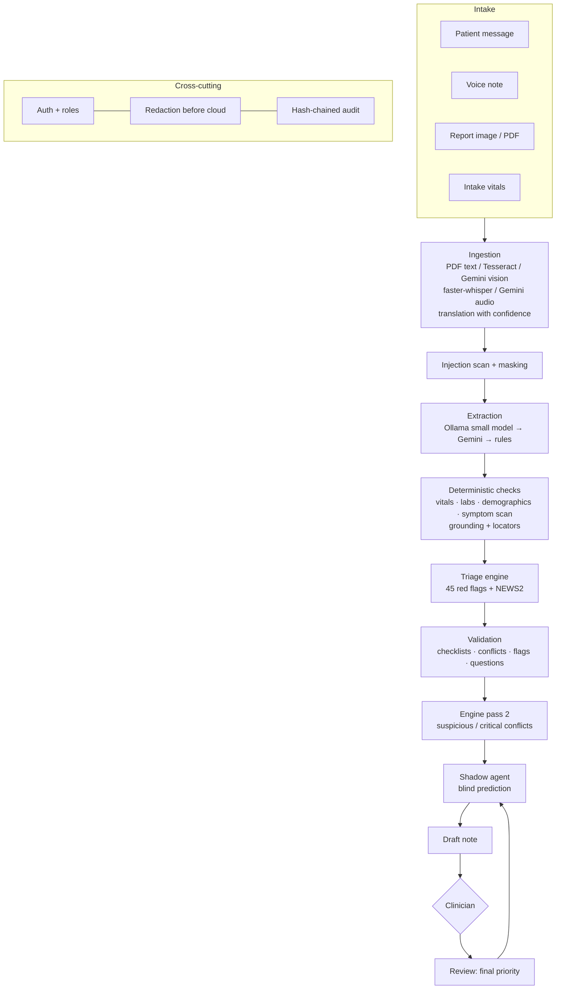

# Architecture

## Layers

1. **Intake** — patient message, optional intake-form vitals, consent. (Phase 2: report images/PDFs, voice notes.)
2. **Ingestion** — `services/ingestion/processor.py`, run once per source.
   - Reports (`documents.py`): PDF text layer → Tesseract → Gemini vision (escalation below 0.75 confidence). Output lines carry page, 0-1000 bounding box, confidence and character span.
   - Voice (`audio.py`): faster-whisper (confidence = exp(avg log-prob)) → Gemini. Segments carry timestamps, confidence and character span.
   - Translation (`translation.py`): small model → Gemini, with self-reported confidence, uncertain phrases and a length-ratio sanity check.
   - Quality flags per source: unreadable (critical), poor legibility, low OCR/ASR confidence, uncertain language, low/unavailable translation, processing failure.
3. **Extraction** — `services/extraction/extractor.py`
   - Provider chain: Ollama small model → Gemini → deterministic `rule_extractor`.
   - Loose model JSON is normalised, validated against `schemas/extraction.py`, and repaired once if invalid.
   - Deterministic cross-checks always run: vitals parser, demographics parser, multilingual negation-aware symptom scanner. Disagreements become `Discrepancy` records.
   - Grounding locates every quote in its source (exact → whitespace-tolerant → fuzzy ≥ 0.8), in the original first and the translation second. Ungrounded facts keep half their confidence and are flagged.
   - Locators map each evidence span to its report line box or voice timestamp; fact confidence is capped by the reading confidence of that line/segment.
   - Lab parser (`labs_regex.py`) normalises Indian unit styles; model vs parser and report vs report disagreements become discrepancies.
3b. **Injection scan** — `services/validation/injection.py` runs on every source (original and translation) before extraction; matched sentences are masked in the model prompt.
4. **Triage engine** — `services/triage/engine.py`
   - Red-flag rules (`rules/red_flags.yaml`), NEWS2 (`vitals_score.py`), model urgency signals, data-quality check.
   - Output: priority, review-time target, sort score, reasons with evidence and references, and a data-quality summary. Always `needs_human_review = true`.
4b. **Validation** — `services/validation/`: checklists (`rules/complaint_checklists.yaml`) → missing items and completeness; conflict checks; unified flags (missing / unclear / conflicting / suspicious); follow-up questions (rule-based, conflict/quality verification items, optional small-model suggestions). The engine runs twice: once to learn which red flags fired (they select checklists), then again with the validation report so suspicious inputs and critical conflicts can lift the priority.
5. **Draft note** — `services/triage/notes.py`, template-based and source-cited.
6. **Review** — clinicians edit (versioned notes), approve, or override with a required reason. Each decision is a `Review` row, which becomes the training signal for the Phase 6 shadow agent.
7. **Audit** — every AI, system and human action is appended to `AuditLog`. Rows are hash-chained (each hash covers the row and the previous hash); `/api/audit/verify` recomputes the chain. Details hold only ids, counts, priorities and rule ids.
10. **Evaluation** — `services/evaluation.py` + `scripts/run_eval.py`: runs the gold-labelled set (`data/eval/eval_cases.json`, development and held-out splits) through the full pipeline in a temporary database for a chosen extraction setup and stores metrics (under-triage of urgent cases first, exact and within-one accuracy, weighted kappa, warning-sign recall, flag precision/recall, latency, every miss) in `data/eval/results/`, shown on the Evaluation page.
9. **Shadow learning** — `services/learning/`: `features.py` (named sparse features), `bandit.py` (full-information contextual bandit, asymmetric reward, abstention, explanations), `shadow.py` (prediction per case before review, blinding, raise-only application in recommendation mode, blind checks, metrics, graduation, mode switch), `memory.py` (similar finalized cases), `simulate.py` (synthetic clinic with hidden clinician judgement). The model is rebuilt from reviewed `ShadowPrediction` rows (cached), never stored as opaque weights.
8. **Security and privacy** — `services/privacy/`: PBKDF2 passwords + JWT (`auth.py`) with a permission matrix enforced by `api/deps.require(...)`; responses are shaped per role in `api/cases.build_detail`; `redaction.py` removes identifiers from any text sent to an external provider and records each call (logged as `data_sent_external`); `api/privacy.py` handles withdrawal (staff or patient code), the erasure queue and erasure.

## Safety invariants (tested in `tests/test_engine.py`)
- The most urgent signal wins; nothing lowers a red flag.
- Model signals can raise routine → P3 only.
- Uncertain or empty extractions are never routine; an unreadable report or voice note lifts the case to at least P3.
- Every red-flag reason carries evidence pointing at real source text.
- Text in an input can never lower a priority; text that tries to instruct the AI lifts the case to at least P3.
- The learned agent can raise a priority only in recommendation mode, never lower one; in shadow mode it has no effect at all.
